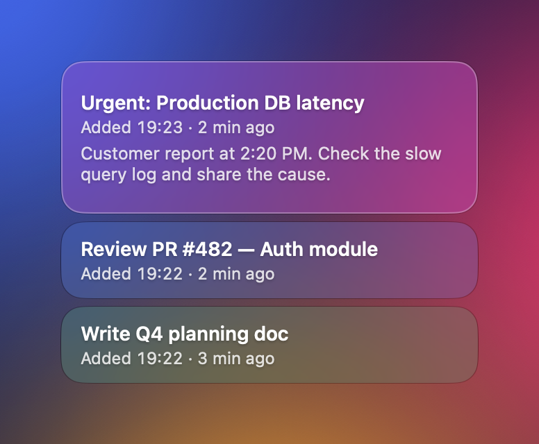
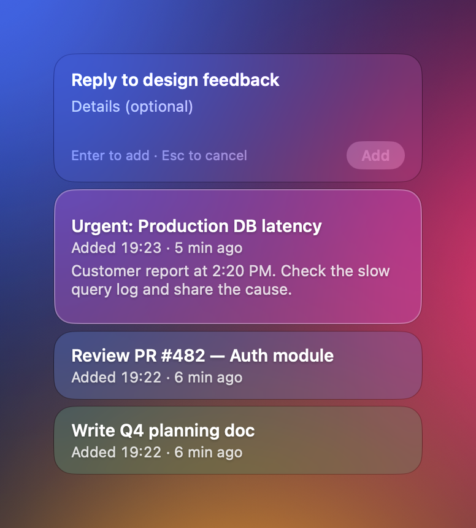

# WorkStack

[English](README.en.md)

**급한 일이 끼어들어도 하던 일을 잊지 않도록, 진행 중인 작업을 화면 위에 블록으로 쌓아 두는 macOS 앱입니다.**



## 이럴 때 쓰세요

보고서를 쓰다가 급한 장애 문의가 들어오면, 지금 하던 일 위에 새 블록을 하나 쌓습니다. 급한 일을 마치고 블록을 완료하면, 아래에 있던 보고서 블록이 다시 맨 위에 보입니다. 평소에는 블록이 0~1개, 끼어든 일이 있을 때만 여러 개가 쌓입니다.

## 주요 기능

- **항상 위에 떠 있는 유리 블록**: 다른 앱, 전체 화면 앱 위에도 보이고, 눌러도 작업 중인 앱의 포커스를 빼앗지 않습니다.
- **스택 추가 / 빠른 추가**: 제목과 상세 설명을 적어 쌓거나, 입력 없이 "새 작업" 블록을 바로 쌓습니다.
- **완료와 되돌리기**: 블록에 마우스를 올려 ✓ 로 완료하고, 4초 안에 되돌릴 수 있습니다. ✎ 로 고칠 수 있습니다.
- **크기에 따라 정보량 조절**: 오버레이를 줄이면 상세 설명 → 시간 → 제목 순으로 숨기고, 아주 작으면 색 블록만 보입니다. 색만 보이는 블록은 마우스를 올리면 제목이 뜹니다.
- **클릭 통과 모드**: 오버레이를 흐리게 두고 클릭이 아래 창으로 그대로 전달됩니다.
- **영문 입력 자동 전환**: 블록 제목을 쓰는 동안 영문 입력으로 바꾸고, 끝나면 원래 입력 소스로 돌아옵니다(설정에서 끌 수 있음).
- **완료 기록**: 완료한 작업은 날짜별로 기록해 둡니다.
- **새 버전 알림**: 새 버전이 나오면 메뉴바 아이콘에 파란 점이 붙습니다.
- 한국어·영어 화면, 로그인 시 자동 실행.



## 설치

1. [최신 릴리스](https://github.com/minssd2/workstack-releases/releases/latest)에서 `WorkStack-<버전>.zip` 을 내려받아 풉니다.
2. `WorkStack.app` 을 **응용 프로그램** 폴더로 옮깁니다.
3. 처음 열 때 "개발자를 확인할 수 없음" 경고가 뜨면, **시스템 설정 → 개인정보 보호 및 보안** 아래쪽의 **그래도 열기**를 누르고 한 번 더 확인합니다.
   - 또는 터미널에서 아래 명령을 실행합니다.
     ```bash
     xattr -dr com.apple.quarantine /Applications/WorkStack.app
     ```

> WorkStack 은 Apple 공증을 받지 않은 개인 배포 앱이라 처음 한 번은 이 허용 과정이 필요합니다.

## 사용법

WorkStack 은 Dock 대신 메뉴바에 아이콘으로 있습니다. 블록 위에 마우스를 올리면 추가 버튼과 크기 조절 손잡이가 나타납니다.

| 동작 | 기본 단축키 |
|---|---|
| 스택 추가 (제목·상세 설명 입력) | ⌃⌥⌘N |
| 빠른 추가 | ⌃⌥⌘J |
| 맨 위 작업 완료 | ⌃⌥⌘D |
| 오버레이 보이기 / 숨기기 | ⌃⌥⌘S |
| 클릭 통과 켜기 / 끄기 | (지정 안 됨) |

단축키는 모두 메뉴바 아이콘 → **설정…** 에서 바꿀 수 있습니다. 입력 블록에서는 Enter 로 쌓고 Esc 로 취소합니다.


## 업데이트

메뉴바 아이콘에 파란 점이 붙으면 메뉴 맨 아래의 **새 버전 … 내려받기** 를 눌러 릴리스 페이지에서 내려받은 뒤, 응용 프로그램 폴더의 앱을 바꿔 끼웁니다. 현재 버전은 메뉴 맨 아래 줄에서 볼 수 있습니다.

## 요구 사항과 개인 정보

- macOS 26 이상 (Apple Silicon, Intel)
- 작업과 완료 기록은 내 맥에만 저장됩니다: `~/Library/Application Support/WorkStack`
- 인터넷은 새 버전 확인(GitHub 공개 릴리스 조회)에만 씁니다. 개인 정보나 사용 기록은 보내지 않습니다.

## 지우기

1. 설정에서 **로그인 시 자동 실행**을 끄고 앱을 종료합니다.
2. 응용 프로그램 폴더에서 `WorkStack.app` 을 지웁니다.
3. 데이터까지 지우려면 `~/Library/Application Support/WorkStack` 폴더를 지웁니다.

## 변경 기록

버전별 변경 사항은 [릴리스](https://github.com/minssd2/workstack-releases/releases) 설명에 있습니다.
