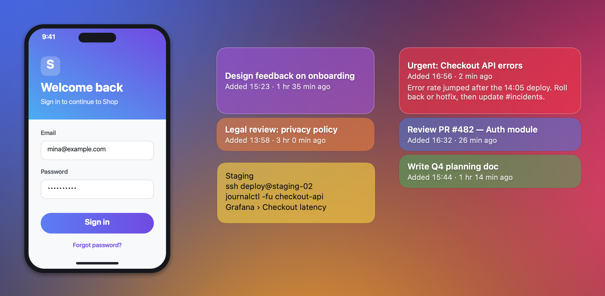
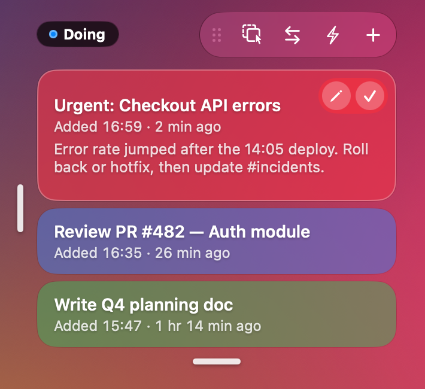
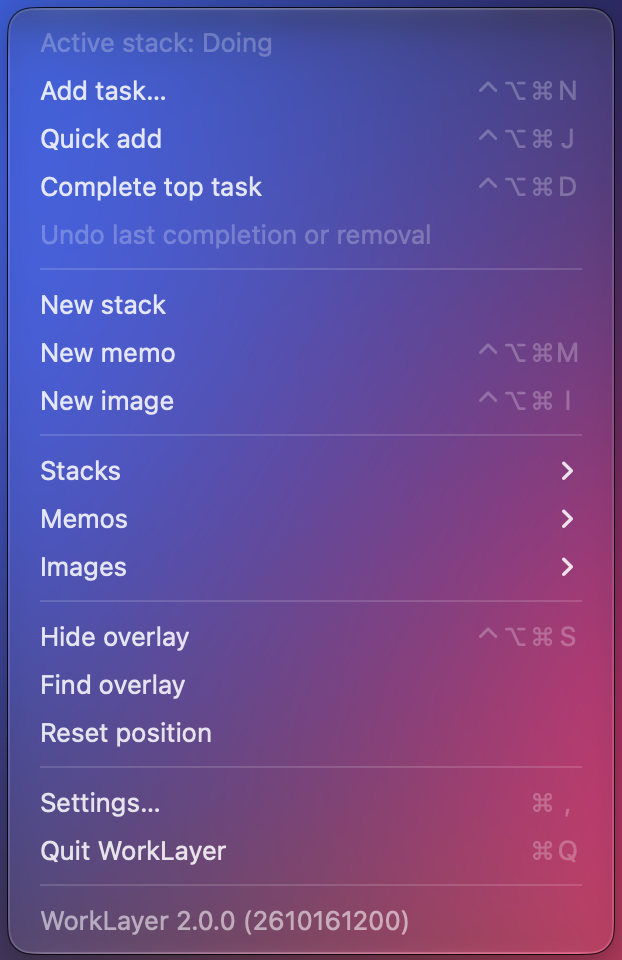

# WorkLayer

[English](README.en.md)

**하던 일, 끼어든 일, 늘 봐야 하는 메모와 참고 이미지를 모든 앱 위에 띄워 두는 macOS 메뉴바 앱입니다.**

> WorkLayer 는 WorkStack 의 2.0 부터 바뀐 이름입니다. 작업 스택 하나였던 앱이 메모와 이미지까지 담는 "화면 위 한 겹"이 되어 이름을 바꿨습니다.



## 왜 필요한가요

일하는 중에 가장 쉽게 잃어버리는 것은 "방금 무엇을 하고 있었는지"입니다. 메신저 문의, 장애 대응, 갑작스러운 회의를 처리하고 돌아오면 원래 하던 일의 흐름이 끊겨 있습니다. 할 일 앱이나 메모 앱은 작업 창 뒤에 숨어 있어서, 일부러 열어 보지 않으면 보이지 않습니다. 서버 주소, 자주 쓰는 명령어, 디자인 시안처럼 일하는 내내 봐야 하는 것도 창을 오가며 찾게 됩니다.

WorkLayer 는 이런 것들을 작업 중인 앱 위에 한 겹으로 얹어 둡니다.

- **늘 보입니다.** 따로 열 필요 없이 다른 앱과 전체 화면 앱 위에 떠 있습니다.
- **방해하지 않습니다.** 눌러도 작업 중인 앱의 포커스와 키 입력을 빼앗지 않습니다. 반투명하게 두거나 클릭이 아래 창으로 그대로 넘어가게 할 수 있습니다.
- **끼어든 일이 순서를 지킵니다.** 새 일은 하던 일 위에 쌓이고, 끝내면 아래에 있던 일이 다시 맨 위에 보입니다.

## 이럴 때 쓰세요

- 보고서를 쓰다가 장애 문의가 들어오면, 지금 하던 일 위에 블록을 하나 쌓습니다. 장애 대응을 마치고 블록을 완료하면 보고서 블록이 다시 맨 위에 보입니다.
- "진행"과 "대기" 스택을 따로 두거나, 모니터마다 스택을 하나씩 둡니다. 답을 기다리는 일은 대기 스택으로 옮겨 둡니다.
- 서버 주소·명령어는 메모로, 디자인 시안·화면 캡처는 이미지로 편집기 옆에 띄워 둡니다. 불투명도를 낮추고 클릭 통과를 켜면 그 아래를 그대로 눌러 쓸 수 있습니다.
- 좋아하는 사진을 이미지로 화면 한쪽에 띄워 두고, 바쁜 와중에도 잠깐씩 마음의 안정을 찾으세요. 반투명하게 두고 클릭 통과를 켜면 일하는 데 걸리적거리지 않습니다.

## 주요 기능

**작업 스택**
- 제목과 상세 설명을 적어 쌓거나(작업 추가), 입력 없이 "새 작업" 블록을 바로 쌓습니다(빠른 추가).
- 블록에 마우스를 올려 ✓ 로 완료하고 ✎ 로 고칩니다. 완료는 4초 안에, 또는 메뉴에서 되돌릴 수 있습니다.
- 스택을 여러 개 만들고 이름을 붙입니다. 단축키는 활성 스택에 동작하고, 스택에 마우스를 올리면 이름표가 보입니다.
- 툴바의 이동 모드(⇄)를 켜고 블록을 끌어 다른 스택으로 옮깁니다. 블록 오른쪽 클릭 "다른 스택으로 보내기"로도 옮깁니다.
- 스택을 줄이면 상세 설명 → 시간 → 제목 순으로 숨기고, 아주 작으면 색 블록만 남습니다.

**메모 카드**
- 텍스트만 담는 카드입니다. ✎ 로 편집을 시작하고, Enter 는 줄바꿈, ⌘Enter·Esc 로 끝냅니다. 쓰는 동안 저장됩니다.
- 오른쪽·아래 손잡이로 폭과 높이를 정하고, 넘친 글은 카드 안에서 스크롤합니다.

**이미지 카드**
- 새 이미지(⌃⌥⌘I)로 띄운 틀에 이미지 파일을 끌어 놓거나 ⌘V 로 붙입니다. 이미지 파일을 스택이나 카드 위로 끌어 놓아도 됩니다.
- 투명한 PNG 는 투명한 부분이 비쳐 보이고, 그 부분의 클릭은 아래 창으로 넘어갑니다.
- 이미지를 누르면 선택되어 가장자리 손잡이로 원본 비율을 지키며 크기를 바꿉니다.

**화면 위에서 방해하지 않기**
- 스택·메모·이미지마다 불투명도를 정합니다. 설정에서 종류별 기본값을 정합니다.
- 스택·메모·이미지마다 클릭 통과를 켤 수 있습니다. 켠 것은 메뉴바 메뉴에서 끕니다.
- 위치 초기화는 모든 스택과 카드를 주 모니터에 서로 겹치지 않게 다시 놓습니다.

**그 밖에**
- 설정에서 켜면 작업 제목을 쓰는 동안만 영문 입력으로 바꾸고, 끝나면 원래 입력 소스로 돌아옵니다(기본 꺼짐).
- 완료한 작업은 날짜별로 기록해 둡니다.
- 새 버전이 나오면 메뉴바 아이콘에 파란 점이 붙습니다.
- 한국어·영어 화면, 로그인 시 자동 실행.

## 설치

1. [최신 릴리스](https://github.com/minssd2/workstack-releases/releases/latest)에서 `WorkLayer-<버전>.zip` 을 내려받아 풉니다.
2. `WorkLayer.app` 을 **응용 프로그램** 폴더로 옮깁니다.
3. 처음 열 때 "개발자를 확인할 수 없음" 경고가 뜨면, **시스템 설정 → 개인정보 보호 및 보안** 아래쪽의 **그래도 열기**를 누르고 한 번 더 확인합니다.
   - 또는 터미널에서 아래 명령을 실행합니다.
     ```bash
     xattr -dr com.apple.quarantine /Applications/WorkLayer.app
     ```

> WorkLayer 는 Apple 공증을 받지 않은 개인 배포 앱이라 처음 한 번은 이 허용 과정이 필요합니다.

## 사용법

WorkLayer 는 Dock 대신 메뉴바에 아이콘으로 있습니다. 메뉴는 작업 → 만들기(새 스택·새 메모·새 이미지) → 스택·메모·이미지 목록 → 화면 → 설정 순으로 묶여 있습니다. 스택에 마우스를 올리면 이름표, 툴바(옮기기 손잡이 · 클릭 통과 · 이동 모드 · 빠른 추가 · 작업 추가), 크기 손잡이가 나타나고, 맨 위 블록에는 ✎ 수정 · ✓ 완료 버튼이 보입니다.



| 동작 | 기본 단축키 |
|---|---|
| 작업 추가 (제목·상세 설명 입력) | ⌃⌥⌘N |
| 빠른 추가 | ⌃⌥⌘J |
| 맨 위 작업 완료 | ⌃⌥⌘D |
| 새 메모 | ⌃⌥⌘M |
| 새 이미지 | ⌃⌥⌘I |
| 오버레이 보이기 / 숨기기 | ⌃⌥⌘S |

단축키는 모두 메뉴바 아이콘 → **설정…** 에서 바꿀 수 있습니다. 입력 블록에서는 Enter 로 쌓고 Esc 로 취소합니다.



## 업데이트

메뉴바 아이콘에 파란 점이 붙으면 메뉴 맨 아래의 **새 버전 … 내려받기** 를 눌러 릴리스 페이지에서 내려받은 뒤, 응용 프로그램 폴더의 앱을 바꿔 끼웁니다. 현재 버전은 메뉴 맨 아래 줄에서 볼 수 있습니다.

## 요구 사항과 개인 정보

- macOS 26 이상 (Apple Silicon, Intel)
- 작업, 메모, 이미지, 완료 기록은 내 맥에만 저장됩니다: `~/Library/Application Support/WorkStack` (이전 이름 그대로입니다)
- 인터넷은 새 버전 확인(GitHub 공개 릴리스 조회)에만 씁니다. 개인 정보나 사용 기록은 보내지 않습니다. 클립보드는 이미지 틀에서 ⌘V 를 누를 때만 읽습니다.

## 지우기

1. 설정에서 **로그인 시 자동 실행**을 끄고 앱을 종료합니다.
2. 응용 프로그램 폴더에서 `WorkLayer.app` 을 지웁니다.
3. 데이터까지 지우려면 `~/Library/Application Support/WorkStack` 폴더를 지웁니다.

## 변경 기록

버전별 변경 사항은 [릴리스](https://github.com/minssd2/workstack-releases/releases) 설명에 있습니다.
